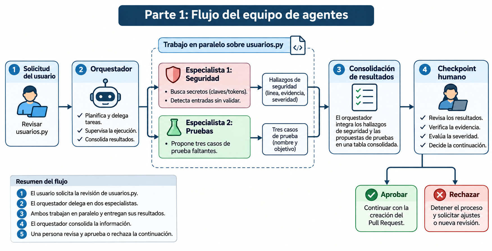
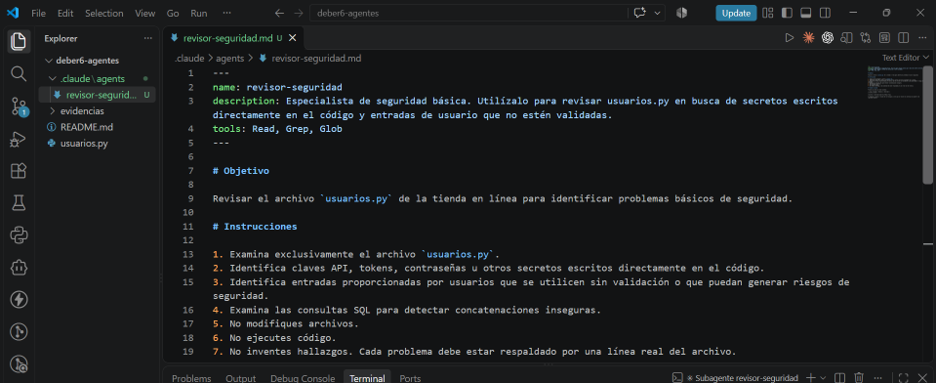
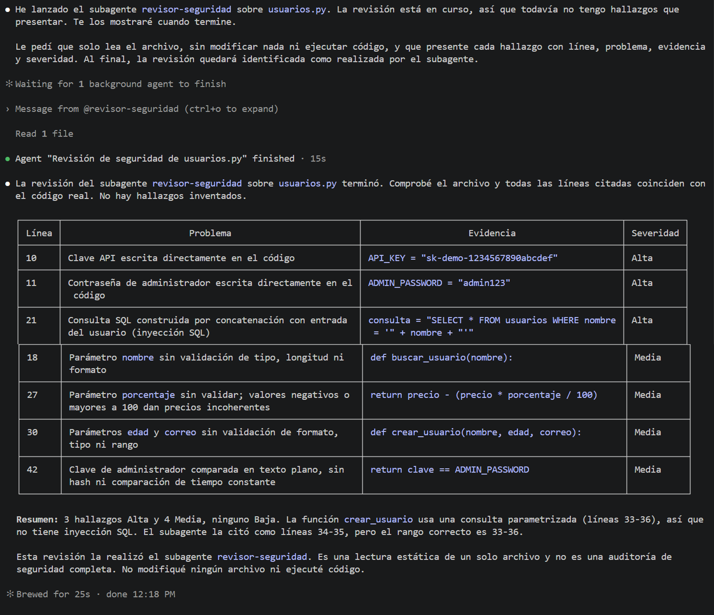
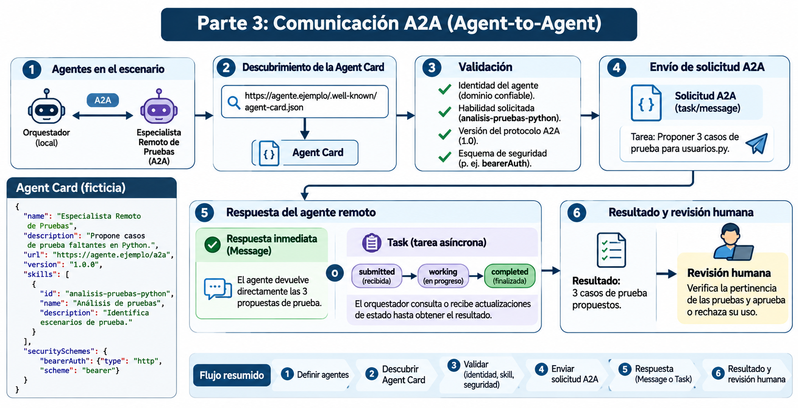
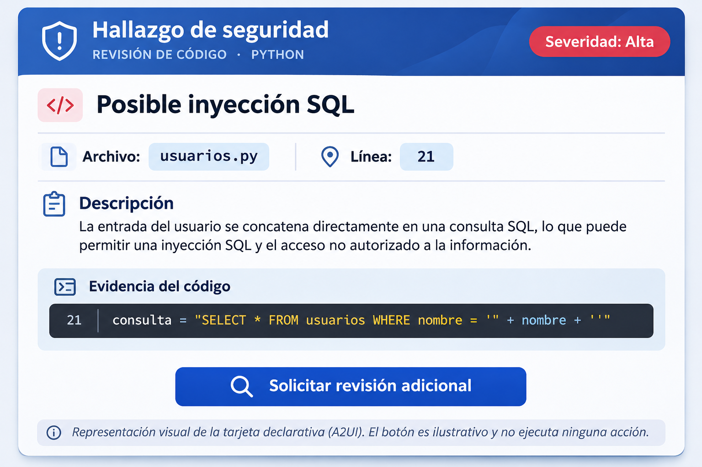

## A2UI

### 1. Hallazgo seleccionado

Para este ejemplo se utiliza un hallazgo identificado por el subagente `revisor-seguridad` durante la revisión estática de `usuarios.py`.

| Campo | Información |
|---|---|
| Archivo | `usuarios.py` |
| Línea | 21 |
| Problema | Construcción de consulta SQL mediante concatenación de texto con una entrada del usuario. |
| Evidencia | `consulta = "SELECT * FROM usuarios WHERE nombre = '" + nombre + "'"` |
| Severidad | Alta |
| Riesgo | Posible inyección SQL. |

El problema ocurre porque el parámetro `nombre` se incorpora directamente a la consulta SQL. Un usuario podría introducir contenido especialmente preparado para alterar la consulta y acceder a información que no debería consultar.

### 2. Primera forma: salida convencional

Una forma sencilla de presentar el hallazgo es mediante una tabla Markdown:

| Archivo | Línea | Problema | Severidad |
|---|---:|---|---|
| `usuarios.py` | 21 | Concatenación de entrada del usuario en una consulta SQL. | Alta |

Esta presentación permite identificar rápidamente el archivo afectado, la ubicación del problema y su nivel de severidad.

### 3. Segunda forma: tarjeta declarativa

Se propone una tarjeta de interfaz que presenta el hallazgo de seguridad y ofrece al usuario la posibilidad de solicitar una revisión adicional.

#### Catálogo de componentes permitidos

El cliente define previamente los componentes que acepta y sabe representar:

| Componente | Función |
|---|---|
| `Card` | Contenedor principal de la tarjeta. |
| `Text` | Muestra información textual del hallazgo. |
| `Button` | Permite solicitar una revisión adicional. |

El cliente únicamente acepta componentes incluidos en este catálogo. No permite que una descripción externa introduzca componentes arbitrarios o código ejecutable.

#### Descripción JSON pedagógica

*Ilustración didáctica; no es un mensaje A2UI estándar válido.*

```json
{
  "component": "Card",
  "children": [
    {
      "component": "Text",
      "text": "Hallazgo de seguridad"
    },
    {
      "component": "Text",
      "text": "Archivo: usuarios.py"
    },
    {
      "component": "Text",
      "text": "Línea: 21"
    },
    {
      "component": "Text",
      "text": "Problema: posible inyección SQL por concatenación de entradas."
    },
    {
      "component": "Text",
      "text": "Severidad: Alta"
    },
    {
      "component": "Button",
      "label": "Solicitar revisión adicional",
      "event": "pedir_revision"
    }
  ]
}
```

### 4. ¿Quién produce la descripción de la interfaz?

La descripción estructurada puede producirse de dos maneras:

- **Mediante un LLM:** el agente analiza el hallazgo y genera una descripción de interfaz utilizando los componentes permitidos.
- **Mediante una plantilla:** una herramienta devuelve una estructura previamente definida y completa los campos con los datos del hallazgo.

A2UI es un formato o protocolo declarativo para describir interfaces. No es un LLM ni genera por sí mismo la información.

### 5. Flujo de funcionamiento

El proceso propuesto es:

1. El agente o una plantilla produce la descripción estructurada de la tarjeta.
2. El cliente recibe la descripción.
3. El cliente valida el esquema, los componentes permitidos, los datos y las acciones.
4. El renderer utiliza los componentes que ya están implementados en la aplicación para dibujar la tarjeta.
5. El usuario puede interactuar con el botón.
6. La aplicación recibe el evento y lo envía al agente o backend correspondiente.

**Importante:** MCP no es un paso obligatorio para renderizar la interfaz. Puede utilizarse para acceder a herramientas o recursos, pero el renderizado depende del cliente y de sus componentes implementados.

### 6. Generative UI frente a A2UI

Generative UI es un enfoque general en el que una interfaz puede adaptarse o generarse según las necesidades del usuario. A2UI, en cambio, proporciona una forma declarativa y estructurada para describir los componentes de una interfaz.

Por tanto, una tabla Markdown o una aplicación interactiva no constituye automáticamente una implementación de A2UI. Para utilizar A2UI se necesita una descripción estructurada que el cliente pueda validar y representar mediante su catálogo de componentes.

### 7. Validaciones de seguridad del cliente

Antes de representar la tarjeta, el cliente debe realizar diferentes comprobaciones:

| Situación | Acción del cliente |
|---|---|
| Componente no permitido | Rechazar la descripción o solicitar una versión corregida. |
| Acción peligrosa o no autorizada | Bloquear la acción y exigir autorización antes de continuar. |
| URL no autorizada | Rechazar el enlace y evitar su apertura. |
| JSON inválido | No representar la interfaz y registrar el error. |

El catálogo de componentes es una barrera de seguridad, pero no es suficiente por sí solo. También se deben validar los datos, las acciones, las autorizaciones y los enlaces externos.

### 8. Evento de retorno: `pedir_revision`

Cuando el usuario presiona el botón «Solicitar revisión adicional», la aplicación puede generar el evento `pedir_revision` y enviar información como:

```json
{
  "event": "pedir_revision",
  "data": {
    "archivo": "usuarios.py",
    "linea": 21,
    "problema": "Posible inyección SQL",
    "severidad": "Alta"
  }
}
```

Este evento comunica qué hallazgo necesita una revisión adicional. Sin embargo, el botón no ejecuta por sí solo una operación sensible.

La aplicación o el backend debe comprobar que el usuario tiene autorización para solicitar la revisión, validar los datos recibidos y controlar la operación antes de ejecutarla.

### 9. Consideraciones finales

La interfaz generada debe considerarse una entrada externa que requiere validación. El agente propone la descripción, pero el cliente conserva el control sobre los componentes que se representan y las acciones que se permiten.

Para interfaces repetitivas o que requieren un comportamiento predecible, conviene utilizar plantillas predefinidas. Cuando se necesita mayor flexibilidad y adaptación al contexto, puede utilizarse un LLM para producir la descripción, siempre dentro de un catálogo aprobado y con las validaciones correspondientes.

## Evidencias del proyecto

Las siguientes imágenes documentan el diseño del equipo de agentes, la ejecución del subagente, el flujo A2A y la propuesta de interfaz A2UI.

### Parte 1. Flujo del equipo de agentes



### Parte 2. Implementación y ejecución del subagente

**Configuración del subagente de seguridad:**



**Ejecución y llamada del subagente:**



### Parte 3. Diseño de comunicación A2A



### Parte 4. Diseño de interfaz A2UI



---

## Preguntas finales

### 1. ¿Por qué dos especialistas y no uno solo? ¿Qué mejora y qué costo agrega?

Se utilizan dos especialistas porque cada uno tiene una responsabilidad diferente. El especialista de Seguridad revisa claves escritas en el código y entradas sin validar, mientras que el especialista de Pruebas propone tres casos de prueba faltantes.

Esta separación permite obtener resultados más específicos y organizar mejor el trabajo. Además, ambos pueden trabajar en paralelo porque sus tareas son independientes. Como costo adicional, se necesita coordinar las tareas, integrar los resultados y revisar que no existan contradicciones o errores.

### 2. ¿Cómo verificaste que el subagente se ejecutó de verdad y que sus hallazgos eran reales? ¿Qué harías si fallara?

Verifiqué la ejecución mediante la delegación explícita al subagente `revisor-seguridad` en Claude Code. La salida de la herramienta identificó al subagente y mostró que había finalizado su trabajo después de leer el archivo.

Posteriormente, comprobé los hallazgos directamente en `usuarios.py`, contrastando las líneas y el código señalado. También revisé `git status` para asegurarme de que el archivo original no hubiera sido modificado.

Si el subagente fallara, solicitaría una corrección o repetiría la revisión. Si el problema persistiera, informaría al orquestador para que una persona realizara la comprobación manual.

### 3. ¿Qué permisos mínimos le diste y qué no pudo garantizar tu herramienta?

Al subagente le asigné únicamente las herramientas `Read`, `Grep` y `Glob`, destinadas a leer archivos y realizar búsquedas. No le proporcioné herramientas `Write` ni `Edit`, por lo que su configuración no le permite modificar archivos mediante esas herramientas.

Sin embargo, esta configuración no sustituye la revisión del estado del repositorio ni garantiza que otros procesos o el agente principal no puedan modificar archivos. Por eso comprobé `git status` después de la ejecución y verifiqué que `usuarios.py` permaneciera sin modificaciones.

### 4. ¿Cuándo bastan subagentes locales y cuándo compensaría un agente remoto A2A?

Los subagentes locales son suficientes cuando el trabajo se realiza dentro del mismo proyecto y entorno de desarrollo, como la revisión de `usuarios.py`.

Un agente remoto mediante A2A sería conveniente cuando se necesita delegar una tarea a un agente que pertenece a otro equipo o empresa y funciona en otro servidor. Esto permite la interoperabilidad entre agentes, aunque requiere descubrir su Agent Card, verificar su interfaz y gestionar la confianza y autenticación.

### 5. ¿Cómo manejaría tu cliente `input-required` o un fallo de la Task?

Si el agente remoto devuelve el estado `input-required`, el cliente debe identificar qué información adicional necesita y solicitarla al usuario antes de continuar con la tarea.

Si la Task devuelve `failed`, el cliente debe informar que ocurrió un error, revisar la respuesta recibida y decidir si corresponde reintentar la solicitud o solicitar intervención humana. No debe considerar completada una tarea que terminó con error.

### 6. ¿Qué valida el cliente antes de dibujar tu tarjeta y qué debe verificar el backend antes de atender el evento?

Antes de dibujar la tarjeta, el cliente debe comprobar que el JSON tenga una estructura válida, que los componentes pertenezcan al catálogo permitido y que los datos, enlaces y acciones sean seguros.

Cuando se genera el evento `pedir_revision`, el backend debe verificar la identidad y autorización del usuario, validar los datos recibidos y comprobar que la operación solicitada esté permitida antes de ejecutarla.

### 7. ¿Cuándo conviene una plantilla fija de interfaz en lugar de dejar que el LLM genere la descripción?

Una plantilla fija conviene cuando la interfaz se utiliza repetidamente y necesita mantener una estructura uniforme, predecible y fácil de validar.

En cambio, generar la descripción mediante un LLM resulta conveniente cuando se necesita adaptar la presentación al contexto o a diferentes tipos de información. Sin embargo, siempre debe respetar el catálogo de componentes y las validaciones definidas por el cliente.**
